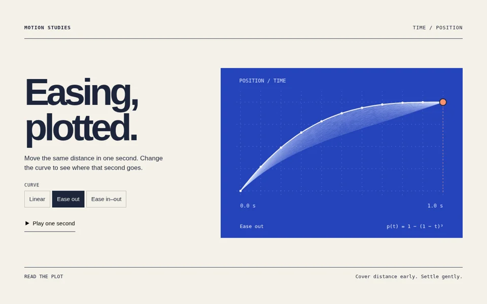

# Easing, plotted.

Open [index.html](index.html) from a local checkout. Compare three curves over exactly one second. Each white dot marks the same elapsed-time increment. The orange marker follows the selected curve. Arrow keys switch between the three radio options. Tab to the playback button and press Space to replay.



The page runs without a package install, account, web server or external asset. Selecting a curve updates its plot, equation and interpretation immediately. The reduced-motion presentation keeps the complete trajectory visible. A static curve and written comparison remain readable when JavaScript is disabled.

## How the study works

[study.js](study.js) owns the three functions, vector artwork and nine-second film. Each film plate lasts three seconds. At 0.72 seconds the orange marker begins a one-second journey. The last position holds until the next plate. The lower ruler uses equal physical distances so an editor can detect timing mistakes in the encoded output. Portrait uses a stacked composition and landscape uses a two-column composition.

The interactive needs one clock, a static plot and a moving cursor. A browser frame callback provides the clock and native controls provide keyboard and touch behavior. This task has no scroll choreography, reusable authored asset state machine or 3D camera that would justify GSAP, Rive, Lottie or Three.js on the page. The video adapters deliberately use the same frame program to isolate rendering differences. Sound is intentionally absent; the equations and motion convey all of the content.

## Reproduce the render

Use a POSIX environment with Node, Python, FFmpeg/ffprobe and a compatible Chromium executable. Run from this directory. The npm installation is local to a disposable tools directory.

```sh
mkdir -p out/tools
npm install --prefix out/tools --no-audit --no-fund \
  @remotion/cli@4.0.487 remotion@4.0.487 react@19.2.7 react-dom@19.2.7 \
  hyperframes@0.9.69 gsap@3.13.0

python render.py hyperframes landscape out/hf-wide.mp4 --tools out/tools
python render.py remotion landscape out/remotion-wide.mp4 --tools out/tools
python render.py hyperframes portrait out/hf-tall.mp4 --tools out/tools
python render.py remotion portrait out/remotion-tall.mp4 --tools out/tools
```

Pass `--browser /path/to/chrome-headless-shell` to select a preinstalled browser. Both adapters use one worker. The command validates the frame count and dimensions and decodes the film before moving it to the requested path. Existing output files are preserved. Chrom(i)um installation, system fonts, host load, codecs and hardware can change bytes and timing. The measured Remotion run used a loopback-only fallback for host network-interface enumeration because the runner blocked that OS call. A normal host can use Remotion's native detection. No paid media provider is involved.

## Verify the result

```sh
python -m venv out/qa
out/qa/bin/pip install playwright==1.62.0 Pillow==13.0.0
out/qa/bin/playwright install chromium
out/qa/bin/python check.py --output out/screens
out/qa/bin/python check_film.py out/hf-wide.mp4 out/remotion-wide.mp4 out/hf-tall.mp4 out/remotion-tall.mp4
ffmpeg -i out/hf-wide.mp4 -i out/remotion-wide.mp4 -lavfi ssim -f null -
```

The browser check also accepts `--browser`. It exercises replay, keyboard selection, a curve change during playback, a live motion-preference change, a touch-emulated phone, and a JavaScript-disabled page. The decoded-marker check compares 18 frames per film with positions calculated independently from the equations. The largest drift across the four samples was 1.27 pixels. [Measured outputs and environment](evidence.json)

| Engine | Landscape render | Landscape bytes | Portrait render | Portrait bytes |
| --- | ---: | ---: | ---: | ---: |
| HyperFrames 0.9.69 | 16.76 s | 218,390 | 15.37 s | 220,030 |
| Remotion 4.0.487 | 28.19 s | 579,385 | 25.10 s | 581,209 |

All four H.264 encodes passed full decode at 24 fps for 216 frames. Pairwise encoded-video SSIM was 0.988616 landscape and 0.990798 portrait. Wall times are single observations with different encoder presets. This fixture establishes interoperability and temporal fidelity for this composition. It supplies no hardware performance, human preference or baseline-versus-skill ranking.
